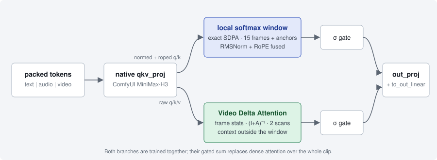

<div align="center">

# Kirei VDN-H3

**VideoDeltaNet (VDN-H3) for the native MiniMax-H3 video model in ComfyUI.**
Exact local attention plus OpenVDN's recurrent branch, tuned for a single GPU.

[](LICENSE)
[](https://github.com/comfyanonymous/ComfyUI)
[](pyproject.toml)
[](tests)
[](https://github.com/OpenVDN/vdn-minimax-h3)



</div>

Kirei VDN-H3 is a ComfyUI custom node that turns the MiniMax-H3 model loaded by
ComfyUI's own loader into the VDN-H3 architecture released by
[OpenVDN](https://github.com/OpenVDN/vdn-minimax-h3). In each of the 50 transformer
blocks, dense attention over the whole clip is replaced by two gated paths whose outputs
are summed:

- an exact **local softmax window**: the frame's 5-frame latent chunk, one chunk on each
  side, two anchor frames and every global row such as text;
- the recurrent **Video Delta Attention** branch, which carries context from the rest of
  the clip at linear cost.

The node loads the released VDN branch weights and the Stage-DMD (8-step) or Stage-B
(50-step) adapters. ComfyUI keeps everything else: checkpoint and quantized loaders,
text encoder, conditioning, audio/video packing, VAEs, sampling and model memory
management. No ComfyUI file is modified.

> Model weights are not included. Follow the licenses of MiniMax-H3 and of the VDN-H3
> checkpoint you use.

**Status.** Version 0.3.3 is available from the GitHub `main` branch. It is not yet
published in the Comfy Registry; install and update it with git as shown below.

---

## Install

### 1. Clone the node

```bash
cd <ComfyUI>/custom_nodes
git clone https://github.com/hyukudan/ComfyUI-Kirei-VDN-H3.git
```

Restart ComfyUI. The package declares no Python dependencies of its own; update it later
with `git pull`.

**Requirements**

- A current ComfyUI with native MiniMax-H3 support.
- A CUDA build of PyTorch with Triton (`triton-windows` on native Windows). Triton runs
  the temporal kernel, FlexAttention and the compiled fusions.
- For INT8/ConvRot bases: comfy-kitchen and a PyTorch **cu130+** build. Older builds run
  comfy-kitchen's slow fallback.

**Optional attention backends.** Installed backends join the attention calibration;
none is assumed to win.

- flash-attn 2 (`flash2`): Ampere or newer, sm_120 included when a wheel exists for your
  torch/CUDA.
- flash-attn-4 (`decomposed`): optional on Linux/WSL2 when its dependencies match
  your environment. Its CUTLASS DSL binary dependencies currently support Linux;
  see [NVIDIA's compatibility requirements](https://docs.nvidia.com/cutlass/latest/media/docs/pythonDSL/quick_start.html#compatibility-requirements).
  FA4 has not been qualified on hardware for this package.

### 2. MiniMax-H3 models

From [Comfy-Org/MiniMax-H3](https://huggingface.co/Comfy-Org/MiniMax-H3), loaded with
ComfyUI's standard loader nodes:

| Model | File | Folder |
|---|---|---|
| Diffusion model, tested | [`minimax_h3_fl2va_pruned_int8_convrot.safetensors`](https://huggingface.co/Comfy-Org/MiniMax-H3/blob/main/diffusion_models/minimax_h3_fl2va_pruned_int8_convrot.safetensors) | `models/diffusion_models` |
| Text encoder | `qwen3vl_32b_minimax_h3_nvfp4_awq.safetensors` | `models/text_encoders` |
| Video VAE | `minimax_h3_video_vae_fp16.safetensors` | `models/vae` |
| Audio VAE | `minimax_h3_audio_vae_fp32.safetensors` | `models/vae` |

A BF16 base also works if it fits in VRAM. The repository also provides the full
`minimax_h3_fl2va_int8_convrot.safetensors` and pruned
`minimax_h3_fl2va_pruned_fp8_scaled.safetensors` variants. The tested pruned INT8
base listed above needs step 4.

### 3. A VDN stage

Download a complete OpenVDN stage directory into `models/vdn`; the `vdn_checkpoint`
dropdown lists the directories found there. Keep the directory intact: Kirei checks the
stage specification, branch inventory, block/head geometry and adapter targets, and
rejects an incomplete checkpoint instead of applying part of it.

```bash
# Stage-DMD: the released 8-step generator
hf download OpenVDN/vdn-minimax-h3 --include "stage-dmd-step-250/*" --local-dir <ComfyUI>/models/vdn
# Stage-B: optional 50-step fidelity reference, used for diagnosis
hf download OpenVDN/vdn-minimax-h3 --include "stage-b-step-2000/*"  --local-dir <ComfyUI>/models/vdn
```

### 4. AdaLN data for pruned bases

Pruned (curve-form) H3 bases store AdaLN as a small curve, and the Stage-DMD AdaLN
adapter terms need extra data to be applied to them. Full bases skip this step.

- **Preferred:** `h3_silu_temb_grid.safetensors`, one copy directly in `models/vdn` or
  inside the selected stage directory. An existing `ComfyUI-MiniMax-H3-Turbo`
  installation may already contain it; Kirei accepts that sibling location only as a
  legacy fallback.
- **Alternative,** used only when no grid is installed: a
  `<stage>/adaln_affine.safetensors` companion with `adaln_basis` and `adaln_mean`. The
  small [published companions](https://huggingface.co/multimodalart/MiniMax-H3-Pruned)
  ship `transformer/adaln_affine.safetensors` for FL2VA/T2VA and
  `transformer_ref/adaln_affine.safetensors` for Ref2VA; install only the one matching
  your base. A supplied curve table or `adaln_table_sha256` is verified against the
  loaded base. This is a portability option, not a quality improvement.

For the tested FL2VA pruned base, download the
[FL2VA affine file](https://huggingface.co/multimodalart/MiniMax-H3-Pruned/blob/main/transformer/adaln_affine.safetensors)
and place it at `models/vdn/stage-dmd-step-250/adaln_affine.safetensors` when using
Stage-DMD without an existing grid.

The Runtime Report's `curve_source` names the file in use, its SHA-256 and whether its
table identity was verified. A legacy grid carries no table identity and reports
`base_table_verified = false`.

---

## Minimal workflow

Insert **Kirei Apply VDN-H3** between the diffusion model loader and the MiniMax-H3
model-sampling node. Text encoding, latents, VAE decoding and saving are the usual
MiniMax-H3 nodes.

```text
Load Diffusion Model ─▶ Kirei Apply VDN-H3 ─▶ MiniMax-H3 model sampling (video 12 / audio 3) ─▶ KSampler
```

Four inputs matter. Everything else has a tooltip and a safe default.

| Input | Value | Why |
|---|---|---|
| `vdn_checkpoint` | `stage-dmd-step-250` | the released 8-step generator |
| `profile` | `auto` | quality-first runtime policy, see below |
| `apply_turbo_adapter` | `true` | Stage-DMD needs **both** adapters at 1.0 |
| `strength` | `1.0` | the released recipe; the per-adapter strengths inherit it |

The complete 1344×768 default-`auto` graph used for validation is available in API
format: [`benchmarks/vdn_auto_768p.api.json`](benchmarks/vdn_auto_768p.api.json).
Use the native `CLIPLoader` with `type = minimax`. The Apply node already loads
the released VDN adapters; do not add a separate H3/Larry turbo LoRA to this recipe.

### Sampling recipe

The sampling trajectory is part of the released model. `res_multistep`, extra steps or
CFG above 1 produce hard, patterned or oversharpened output even when the checkpoint is
correct.

| | Stage-DMD (`stage-dmd-step-250`) | Stage-B (`stage-b-step-2000`) |
|---|---|---|
| Sampler / scheduler | `euler` / `simple` | `euler` / `simple` |
| Steps | **8** | **50** |
| Denoise / CFG | 1.0 / **1.0** | 1.0 / 1.0 |
| Shifts (video / audio) | 12 / 3 | 12 / 3 |
| Adapters | default 1.0 + turbo 1.0 | default 1.0, turbo **off** |
| Profile | `auto` | `reference` (numerical oracle) |

If a Stage-DMD result looks wrong, render the same prompt with Stage-B. If 50 steps are
already off, check the setup (checkpoint, AdaLN data, window handling) before blaming the
distillation adapter.

---

## What `auto` chooses

`auto` is quality-first: local attention and adapters stay exact, and the VDN projection
stays BF16 whenever the branch is resident.

| Situation | Adapters | VDN projection | Branch storage | Local attention |
|---|---|---|---|---|
| BF16 base | merged (one fp32 delta, one rounding) | BF16 | resident | calibrated exact winner |
| INT8 / FP8 / NVFP4 / MXFP8 base | activation-space bypass, `mlp.fc2` included | BF16 | resident | calibrated exact winner |
| Not enough headroom (total VRAM minus the base model) | bypass | may follow an INT8/FP8 base (approximate) | hybrid or stream; exact 5-frame tiles on cards ≤ 32 GB | calibrated exact winner |
| Reference/keyframe rows would make grouped attention copy too much | as above | as above | as above | calibrated winner when the peak fits; Flex without calibration on peak-memory risk |

### What is exact and what is not

- **Local attention.** The windows run only on exact backends: grouped SDPA (through
  ComfyUI's exact SDPA dispatch), FlexAttention, or the FA2/FA4 varlen decompositions. A
  candidate can win calibration only after matching the grouped oracle. ComfyUI's global
  SageAttention or quantized-attention overrides do not reach the windows unless you
  select `attention_backend = compat`, which may use approximate kernels.
- **Adapters.** On BF16 bases they are merged with one fp32 delta and a single rounding.
  On quantized bases they run as an activation-space bypass, so quantized weights are
  never requantized and the update is not rounded away; merging would cause the
  softening seen with merged LoRAs on INT8/FP8 bases. Bypass does not make a quantized
  base equal to the BF16 model.
- **Backbone vs. VDN projection.** Backbone quantization comes from the H3 checkpoint you
  load. The VDN `to_out_linear` projection is a separate choice: BF16 when resident, and
  possibly INT8/FP8 when `auto` streams the branch over an INT8/FP8 base to reduce
  transfers. That is approximate and reported as `projection.precision`. Resident
  INT8/FP8 projections stay explicit experiments: INT8 did not beat BF16 on the recorded
  workstation runs.
- **Memory scheduling.** Hybrid/stream storage and N-frame tiling change where weights
  live and how activations are materialised, not the window or recurrence equations.
- **AdaLN.** On full bases the modulation is activated from the fp32 time embedding, as
  in OpenVDN's patched diffusers (`adaln_fp32`, on by default); ComfyUI would otherwise
  round it to BF16 first. Curve-form bases already evaluate their curve in fp32, so they
  report `adaln_fp32 = false` with non-zero `curve_factors`.
- **Cholesky checks.** In CUDA inference, the SPD status of the per-frame Cholesky
  factors is collected during each model forward and checked once before the forward
  returns, instead of synchronising after every factor. A failed factorization still
  raises before its result leaves the forward. CPU, autograd, standalone, compiled and
  captured calls keep immediate checking.

### Profiles

| Profile | Use it for | What changes |
|---|---|---|
| `auto` | everything | the tables above |
| `low_vram` | forcing the 24 GB layout | hybrid storage, exact 5-frame tiles, bypass adapters |
| `reference` | the numerical oracle | eager branch, grouped SDPA, BF16, no compile |
| `max_speed` | experiment only | resident branch, adapters **merged** (requantized on quantized bases), quantized projection, CUDA graphs; not qualified as faster or same quality |
| `balanced` | legacy conservative preset | automatic placement, BF16 projection, exact attention |
| `compat_reference` | compatibility comparison | eager streamed branch, BF16 projection, Comfy attention overrides |
| `experimental_fp8` | experiment only | automatic placement with FP8 VDN projection |
| `workstation_fp8` | experiment only | resident FP8 projection, merged adapters, automatic parallel-branch candidate |

A profile name is not a benchmark result.

<details>
<summary><b>Advanced inputs</b> (collapsed in the node; every one has a tooltip)</summary>

| Input | Options | Notes |
|---|---|---|
| `default_adapter_strength`, `turbo_adapter_strength` | -1 … 2 | per-adapter strength; -1 inherits `strength` |
| `lora_mode` | auto, bypass, merge | auto merges on BF16 bases and bypasses on quantized ones; merging into a quantized base requantizes the weight |
| `branch_mode` | auto, resident, hybrid, stream | where the VDN branch lives; auto budgets total VRAM minus the base model |
| `attention_backend` | auto, grouped, flex, flash2, decomposed, reference, compat | auto calibrates exact kernels once per geometry/environment; compat delegates to ComfyUI and may be approximate |
| `projection_precision` | auto, bf16, int8, fp8 | precision of the VDN `to_out_linear` GEMM; int8 / fp8 are quality-gated experiments |
| `kernel_backend` | auto, triton, conv1d, eager | temporal-conv and activation kernels of the linear branch |
| `compile_policy` | auto, off, shared, reduce_overhead, max_autotune | torch.compile policy for the fused bodies; reduce_overhead is CUDA graphs |
| `tile_frames` | 0 … 64 | 0 lets the profile choose; N runs the branch in exact N-frame tiles |
| `pin_strategy` | auto, comfy, all, none | pinned host memory for streamed branch weights |
| `branch_execution` | auto, serial, parallel | parallel is an experimental second CUDA stream, resident weights only |
| `adaln_fp32` | on / off | request fp32 AdaLN activation on full AdaLN bases; curve-form bases already use their fp32 curve path and do not install this patch |
| `strict_validation` | on / off | check every branch tensor against the loaded H3 geometry before applying |
| `diagnostics` | on / off | per-stage CUDA-event timings and memory in the Runtime Report |

Use `reference` instead of rebuilding the numerical oracle from these switches.

</details>

---

## Settings by GPU

Keep `profile = auto` on every card; these notes say what it will pick and what to check.
The attention calibration runs once per geometry and software environment, verifies
parity and stores the winner in `models/vdn/vdn_h3_calibration.json`.

**RTX PRO 6000 Blackwell / RTX 50xx (sm_120).** With an INT8 or FP8 base and enough
VRAM, `auto` keeps the branch resident with a BF16 projection and bypass adapters. This
family is not a B200: it has no tcgen05 path and 99 KB of shared memory, so OpenVDN's
B200 FA4 numbers do not apply. flash-attn-4's sm_120 kernel (mma.sync) is one more
calibration candidate next to grouped SDPA, Flex and FA2; FA4 has not yet been validated
on hardware for this package. The Runtime Report names the generation as `fa4_kernel`.

**RTX 4090 and other 24 GB cards.** When the branch does not fit next to the base, `auto`
uses hybrid or streamed branch storage with exact 5-frame tiles; over an INT8/FP8 base
the streamed projection follows the base precision (approximate). Block fusion is off
while streaming, as expected. `low_vram` forces hybrid storage and tiling.

**H100 / H200 / B200.** With flash-attn-4 installed, its decomposition joins the
available exact calibration candidates. The heuristic prefers FA4 when applicable,
but the calibrated winner takes precedence. No results on
these GPUs are recorded for this package.

**Native Windows.** The tested setup has no FA4 backend; CUTLASS DSL's current binary
dependencies are Linux-only. The available candidates are grouped
SDPA, Flex through `triton-windows`, and FA2 when a wheel for your torch/CUDA is
installed. The Runtime Report shows `fa4_available = false` next to `fa4_kernel`.

**Machines shared with other PyTorch/Triton workloads.** Give ComfyUI its own compile
caches in the launcher so unrelated runtimes cannot reuse each other's artifacts:

```bat
set "TORCHINDUCTOR_CACHE_DIR=<ComfyUI>\user\.cache\torchinductor-comfyui"
set "TRITON_CACHE_DIR=<ComfyUI>\user\.cache\triton-comfyui"
```

---

## When VDN pays off

VDN replaces dense attention over the whole clip with a local window plus a linear
branch. The saving grows with sequence length; on short low-resolution clips the branch
and its extra projection cost about as much as the attention they replace. The table is
a FLOP model, not a measured speed-up.

| Geometry | Dense ÷ VDN FLOPs per block |
|---|---:|
| 608×352 · 121 f | 1.02× (break-even) |
| 960×544 · 121 f | 1.14× |
| 608×352 · 241 f | 1.21× |
| 1280×736 · 145 f | 1.38× |
| 1344×768 · 345 f | 2.53× (OpenVDN measured 2.65× on a B200) |

The FLOP model puts the linear branch at 6–8 % of block computation; that is not its
share of runtime (one 768p run with compile off measured about 20 % of warm block time).
At 608×352 with 121 and 241 frames, the recorded RTX PRO 6000 runs of VDN were slower
than dense H3 with a turbo LoRA. If VDN is slower at a geometry where the model predicts
a win, compare warm runs and check the attention backend, projection precision and branch
placement in the Runtime Report. Measurements and protocol:
[`docs/PERFORMANCE.md`](docs/PERFORMANCE.md).

---

## Supported formats and limits

| | Supported | Notes |
|---|---|---|
| H3 base precision | BF16, FP8 scaled, INT8/ConvRot, NVFP4, MXFP8; W4A4/W4A8 layouts are recognised | default `auto` uses bypass on quantized bases; families without a matching VDN projection keep it in BF16 |
| H3 AdaLN form | full bases; pruned curve-form bases with the e-grid or an affine companion | see install step 4 |
| VDN checkpoints | complete OpenVDN Stage-DMD and Stage-B directories (BF16) | pre-quantized full-branch files are not supported; INT8/FP8 projection is a runtime option |
| Local attention | grouped SDPA, Flex, FA2, FA4 decomposition (exact); `compat` (Comfy overrides) | see [Settings by GPU](#settings-by-gpu) |
| Sequence packing | ComfyUI's native uniform H3 packing | [VDN-H3-Plus](https://github.com/xmarre/ComfyUI-VDN-H3-Plus) mixed-grid / Flow-Aligned Regenerate workflows are not compatible |

- One GPU per patched model. MultiGPU shallow clones are rejected; a distributed port
  would need real sharding.
- One Apply node per MODEL. Applying VDN twice, or after another attention patch, is
  rejected; apply VDN first.
- Released geometry only: the checkpoint's `linear_head_dim` must equal H3's attention
  head dimension (128).
- H3 aligns the requested frame count to its temporal grid; that is expected.
- Kirei scopes ComfyUI's allocation-graph compiler off for its model call and restores
  your setting afterwards, also on errors. Its own `compile_policy` is separate.
- Not shipped: [VELA](https://github.com/Speach1sdef178/ComfyUI-VELA-H3)'s selective
  Sage / attention islands, approximate QKV policies, anchor-column pruning and retained
  scratch caches. An exact analogue of VELA's three-window batching was slower and used
  more temporary memory on RTX 4090, so it is not enabled.

---

## Diagnostics

Connect **Kirei VDN-H3 Runtime Report** after the apply node (and its `after` input to
the sampler output for a post-render report) and confirm:

1. `euler` / `simple` / 8 steps / denoise 1.0 / CFG 1.0, shifts 12 / 3;
2. `adapters.active = [default, turbo]`, both strengths 1.0;
3. `adapters.lora_mode = bypass` on a quantized base; full AdaLN bases report
   `adaln_fp32 = true`, curve-form bases report non-zero `curve_factors`;
4. `projection.precision = bf16` before any INT8/FP8 experiment;
5. `attention_calibration` names an exact backend (grouped, flex, flash2, decomposed);
6. Stage-B / 50 steps with `reference` separates setup problems from distillation ones.

Other useful fields: `attention_failures` and `block_fusion_error` show latched
fallbacks; `attention_calibration.dispatch_reason` explains the backend choice;
`cholesky_checks` counts deferred factors and validated forwards. With
`diagnostics = on` the report adds per-stage CUDA timings (including
`linear.cholesky_check`) and memory.

### Troubleshooting

| Symptom | Likely cause | Fix |
|---|---|---|
| Hard, patterned or oversharpened frames | `res_multistep`, 4 steps on the 8-step checkpoint, or CFG > 1 | use the recipe above |
| Soft output on an INT8/FP8 base | adapters merged (`max_speed` or `lora_mode = merge`) | `auto` or `lora_mode = bypass` |
| Out of memory on the first run with reference images | grouped attention copies every global row into every window | check `attention_calibration.dispatch_reason`; `auto` selects Flex before an unsafe peak-memory calibration, and `low_vram` also reduces branch residency |
| Worried about a stale attention winner after an update | the calibration signature includes the node version, torch/CUDA/driver, Triton, flash-attn versions and installed backends | a changed environment recalibrates by itself; delete `models/vdn/vdn_h3_calibration.json` to force it |
| INT8 base is slow | torch build older than cu130: comfy-kitchen falls back | install a cu130+ build or use the `fp8_scaled` base |
| Dropdown shows the placeholder instead of a checkpoint | the stage directory is not under `models/vdn` | move it there and refresh the node list |
| "VDN-H3 is already applied to this MODEL" | one model was patched twice | keep a single Apply node per model |
| Slower than base H3 at 608×352 · 121 f | expected near break-even | measure at 241 frames or 720p and compare warm medians |

---

## Nodes

| Node | Category | Purpose |
|---|---|---|
| **Kirei Apply VDN-H3** | `model_patches/video` | apply the VDN branch, adapters and runtime policy |
| Kirei VDN-H3 Runtime Report | `…/advanced` | resolved runtime as JSON: recipe, adapters, precision, attention, layout rows, memory |
| Kirei VDN-H3 Calibrate Attention | `…/advanced` | benchmark the exact attention backends for one geometry, verify parity, persist the winner |
| Kirei Release VDN-H3 Weights | `…/advanced` | free VDN caches and auxiliary weights |
| Kirei Benchmark Scenario / Sampling / Start / End | `…/benchmark` | recipe-locked benchmark protocol, see [`benchmarks/README.md`](benchmarks/README.md) |
| Kirei Apply VDN-H3 (Legacy) | `…/legacy` | compatibility with old saved workflows |

The branch, adapter and curve weights are registered as ComfyUI additional models and
follow its offload and memory accounting. **Kirei Release VDN-H3 Weights** frees the
caches explicitly; the legacy node id keeps old saved workflows loading.

---

## Validation

What has been checked, and what has not. Details are in
[`docs/VALIDATION.md`](docs/VALIDATION.md) and [`docs/PERFORMANCE.md`](docs/PERFORMANCE.md).

- **CPU tests.** The full suite (204 tests in 0.3.3) passes against unmodified ComfyUI
  `0b5b009d`. It includes 20 reduced FP32 oracles that execute pinned OpenVDN source
  (`b8cb28fb`): window/anchor semantics, delta rules, statistics and scans, short
  convolution, reduced linear/hybrid branches and paired video/audio timesteps at 8 and
  50 steps. These oracles do not cover CUDA kernels, RoPE, quantized trained weights or
  full-video parity with OpenVDN. The dependency-light CI subset is 173 of those tests.
  Regression tests also cover coexistence with ComfyUI's
  native bypass LoRAs in both orders, the native `attention` override on compiled blocks,
  AdaLN source reporting, exact short full-cover attention and the deferred Cholesky
  scope (failed factors, nesting, cancellation, validation before return).
- **CI.** Three GitHub Actions jobs: a dependency-light CPU subset, the full suite on
  pinned ComfyUI with the OpenVDN oracles, and the full suite on current ComfyUI. All
  three passed for the 0.3.3 implementation ([run](https://github.com/hyukudan/ComfyUI-Kirei-VDN-H3/actions/runs/38086524726)).
- **Generation, recorded with 0.3.2.** On clean pinned ComfyUI, the default-`auto`
  recipe rendered 1344×768, 124 frames at 24 fps with AAC audio, without errors, on:
  - RTX PRO 6000 Blackwell 96 GB: resident branch, BF16 projection, FA2, compiled block
    path (each of the four block stages ran 400 times);
  - RTX 4090 24 GB: streamed branch, 5-frame tiles, INT8/ConvRot projection, FA2.

  One prompt and seed. Five sampled frames per clip showed a recognizable runner and
  market without noise collapse, with motion blur and incomplete prompt adherence. The
  INT8 clip differs in face, clothing and composition, so it is not a quality-equivalence
  result. Audio presence was checked, not its content, and these single runs are not
  speed measurements.
- **Generation regression, 0.3.3.** The same recipe and seed on the RTX PRO 6000 ran
  with deferred Cholesky checks (800 factors validated over 8 forwards), block fusion
  on and no attention failures. All 124 decoded H.264 frames were bit-identical to the
  0.3.2 clip. This is a one-clip decoded-pixel check, not raw-latent or audio equality,
  general quality or parity with OpenVDN's trained video.
- **Component measurements** (not full-render speed):
  - deferred Cholesky checks (0.3.3): 7.81 % less wall time for the production factor
    workload on RTX 4090 (800 factor calls per run, synthetic SPD inputs, five warm
    medians), bit-identical output, +0.44 MiB peak;
  - FA2 decomposition (0.3.2): 518 MiB lower peak allocation at a 768p geometry,
    bit-identical output;
  - grouped-attention buffer lifetimes: 105–386 MiB lower temporary peak at three
    geometries on RTX 4090, bit-identical output;
  - rejected: an `mlp.fc2` activation reorder (identical output, unchanged peak, no
    consistent timing benefit on PRO 6000 and RTX 4090).
- **Pending:** five-run warm medians for full renders, reviewed video/audio quality, FA4
  on hardware, hybrid storage, long or reference-heavy clips, and end-to-end parity with
  OpenVDN. Remaining work is tracked in the [improvement plan](docs/IMPROVEMENT_PLAN.md).

---

## Documentation and tests

- [`docs/ARCHITECTURE.md`](docs/ARCHITECTURE.md): the block, branch, attention dispatch, adapters and memory policy.
- [`docs/PERFORMANCE.md`](docs/PERFORMANCE.md): FLOP model, measured results, per-card policy and protocol.
- [`docs/VALIDATION.md`](docs/VALIDATION.md): recipes, quality gates and recorded qualification runs.
- [`docs/IMPROVEMENT_PLAN.md`](docs/IMPROVEMENT_PLAN.md): implemented, rejected and pending work.
- [`benchmarks/README.md`](benchmarks/README.md): benchmark scenarios, recorder and comparison tooling.
- [`CHANGELOG.md`](CHANGELOG.md).

From a git checkout, the tests run on CPU without a GPU: `python -m pytest -q`. The
source oracles are skipped unless `OPENVDN_ROOT` points to an OpenVDN checkout at the
pinned commit; [`.github/workflows/ci.yml`](.github/workflows/ci.yml) shows the complete
setup. The CUDA probes run with the Python that runs ComfyUI, from any directory:

```bash
python <ComfyUI>/custom_nodes/ComfyUI-Kirei-VDN-H3/tests/probe_optimized_cuda.py --device cuda:0 --json probe-core.json
python <ComfyUI>/custom_nodes/ComfyUI-Kirei-VDN-H3/tests/probe_domestic_cuda.py --device cuda:0 --json probe-domestic.json
python <ComfyUI>/custom_nodes/ComfyUI-Kirei-VDN-H3/tests/probe_flex_cuda.py
```

The core probe uses Q/K/V with the strides of the real fused projection, runs the real
calibration into a scratch store and times grouped, Flex, FA2 and FA4. The Flex probe
pushes twelve packed lengths through one dynamic compiled call and must print `PASS`.

## Credits and license

VDN mathematics, the released checkpoints and the tuned inference design are the work of
**OpenVDN** ([vdn-minimax-h3](https://github.com/OpenVDN/vdn-minimax-h3),
[openvdn.github.io](https://openvdn.github.io/)). Kirei's contribution is the native
ComfyUI integration: model patching, exact attention dispatch, quantized-base
compatibility, memory lifecycle, profiling and workstation execution.

Code is licensed under [Apache-2.0](LICENSE); see [`THIRD_PARTY.md`](THIRD_PARTY.md) and
[`NOTICE`](NOTICE) for attribution. Model weights are distributed separately under their
own terms.
